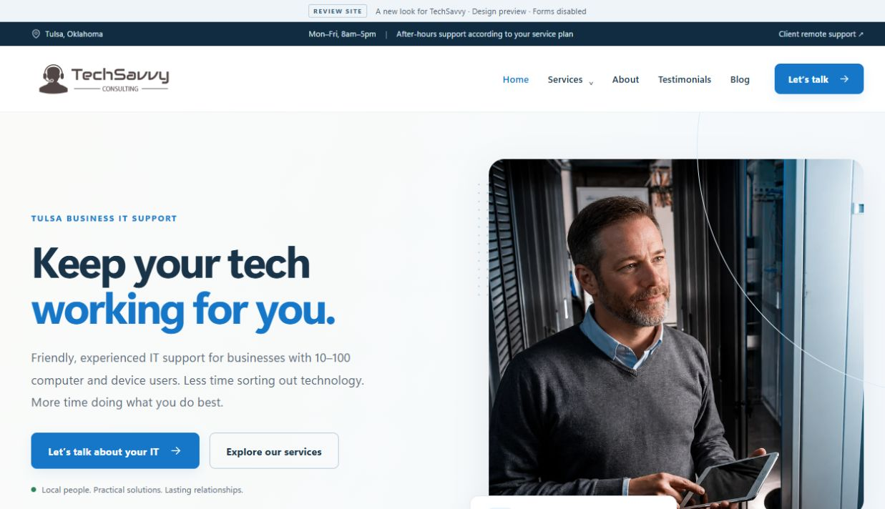

# TechSavvy Consulting · Website review

A modern, host-independent design example for TechSavvy Consulting. The production Wix website remains at **www.techsavvy.consulting**.

**Status:** review build only. Hosting is undecided. Forms are inactive and optional tracking is absent. Nothing in this repository changes Wix, DNS, Microsoft 365 or advertising destinations.

## Preview the design

The running preview on the build computer is **http://127.0.0.1:4321/**. This is a local address, not a public hosted website; it works only on that computer while the preview server is running.

You can review these screenshots directly in GitHub on any signed-in device:



- [Mobile homepage](docs/preview-mobile.png)
- [Desktop support/founder sections](docs/preview-desktop-sections.png)
- [Desktop callback form](docs/preview-desktop-contact.png)

## What is included

- All 13 current main-page addresses and three original blog article addresses.
- A new homepage, responsive navigation, service cards, founder section, existing testimonial excerpt, local video and clearer contact actions.
- Five detailed service/approach pages, About, Contact, FAQs, Blog and the existing policy texts for reference.
- A separate thank-you screen and proper 404 screen.
- Review-mode forms with no endpoint, storage or submission delivery.
- Local assets and system fonts; no optional analytics, advertising tags or automatically loaded third-party embeds.
- Existing canonical addresses retained as migration metadata. Every page is marked noindex.
- `/search-lp` → `/contact` and `/home-1` → `/` redirects in the local preview, with example hosting configuration kept separately.

## Run it

Use Node.js 24 and npm. No API keys or hosting account are required.

```sh
npm ci
npm run build
npm run verify
npm run preview
```

Open **http://127.0.0.1:4321/**. Press Ctrl+C in the terminal to stop the preview. If port 4321 is occupied, set the `PORT` environment variable before starting.

For source editing with hot reload, use `npm run dev`. Use `npm run preview` to verify the built example, including headers, redirects and 404 behavior.

## Editing guide

| Area | File |
| --- | --- |
| Homepage | `src/pages/index.astro` |
| Shared header, footer, metadata | `src/layouts/BaseLayout.astro` |
| Design and responsive layout | `src/styles/global.css` |
| Service content | `src/data/services.ts` |
| About, Contact, FAQs | `src/components/StandardPages.astro` |
| Blog content | `src/data/blog.ts` |
| Blog article layout | `src/components/BlogArticle.astro` |
| Form layout and review safeguards | `src/components/ContactForm.astro` |
| Original public-site inventory | `src/data/source-inventory.json` |

Image originals are in `assets/originals/`; optimized WebP files are in `public/images/`. Run `npm run assets` to regenerate those derivatives. Video is served locally from `public/videos/`.

## Before considering production

See [review notes](docs/REVIEW-NOTES.md), [asset provenance](docs/ASSET-SOURCES.md) and [verification](docs/VERIFICATION.md). Select a host, review copy and permissions, implement and test real form delivery, update provider-specific policies, verify SEO/Search Console details, and obtain production-transition approval.

The noindex safeguards are intentionally hardcoded. A future production release requires a deliberate review of them; there is no automatic production switch.
